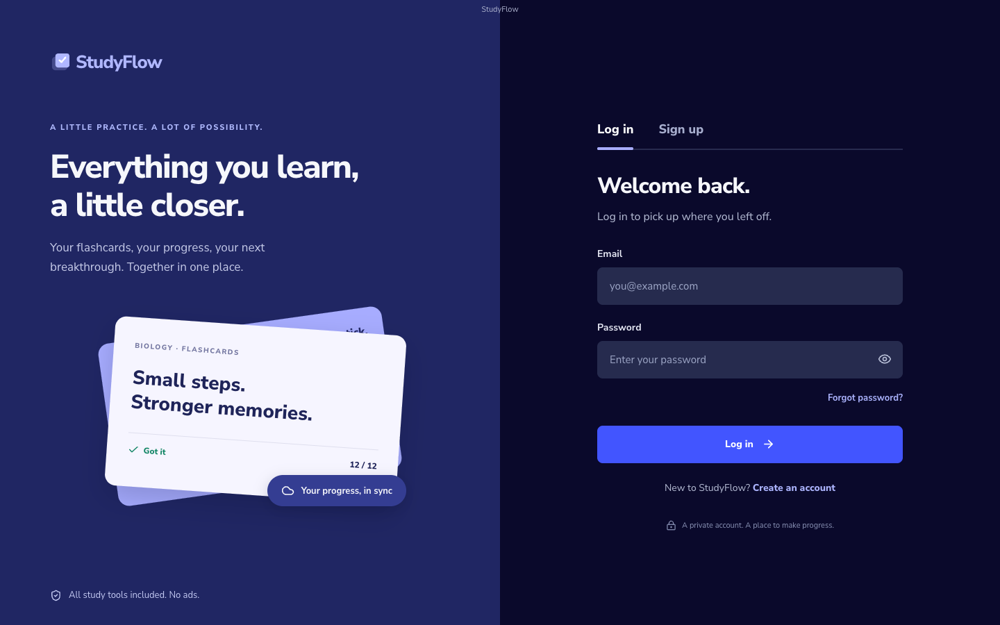

<div align="center">
  
  <h1>StudyFlow</h1>
  <p><strong>An independently reverse-engineered recreation of Quizlet for macOS and Windows.</strong></p>
  <p>Flashcards · Learn · Test · Match · Write · Spaced repetition</p>
</div>



**StudyFlow reverse engineers Quizlet’s visible interface and core study workflows into a standalone desktop app.** The recreation was built by inspecting the live Quizlet experience and rebuilding its layouts, controls, and study interactions with original code. It runs on macOS and Windows, supports email/password accounts, and saves private libraries and study progress through Supabase. There are no advertisements or reserved ad slots.

This is an independent, MIT-licensed implementation with original branding, artwork, and sample study content. StudyFlow is not affiliated with or endorsed by Quizlet.

## Reverse engineering Quizlet

The reference work covered Quizlet’s Home feed, library, study-set overview, flashcards, Learn setup and questions, Test setup, and card editor. StudyFlow recreates the observed navigation, dark interface, card layouts, setup dialogs, and study controls, alongside independently implemented learning and grading logic.

The project includes five working study modes—**Flashcards, Learn, Test, Match, and Write**—plus spaced review, imports, folders, search, and cloud libraries. The [reference observations](docs/REFERENCE.md) and [implementation report](docs/IMPLEMENTATION.md) document the reconstruction, verification, differences, and unavailable reference screens. Exact pixel parity and complete Quizlet feature parity are not claimed.

## Download

Get the Mac (Apple silicon) or Windows x64 preview from [GitHub Releases](https://github.com/atratheking/studyflow/releases). The preview installers are unsigned; Windows execution remains unverified. Public signup and recovery email delivery still require an SMTP provider, so self-hosters should follow the backend setup below.

## Get started

Requirements for development: Node.js 24, npm, and a Supabase project. Follow [online account setup](docs/ONLINE-SETUP.md) to apply the database migration and set the two public connection values in `.env.local`. No privileged database key belongs in the app.

```sh
npm ci
# Configure .env.local using .env.example and docs/ONLINE-SETUP.md
npm start
```

`npm start` compiles and opens the desktop app. Without cloud configuration the login screen explains that account setup is pending. It does not open an offline library. For live development in a desktop window:

```sh
npm run desktop:dev
```

`npm run dev` serves the renderer for UI development and tests; a running development server is not required by the packaged app.

## Your account

Log in with an email and password, create an account, confirm your email, recover a password, change your password from Profile, and sign out. Sessions persist across restarts. Each account has its own library; database row-level security enforces ownership. Cloud writes use revisions to reject stale updates from another computer. Failed saves offer recovery/export instead of silently losing work.

Email codes and the default Supabase confirmation links are supported inside the desktop app. **Public signup/recovery email delivery still needs custom SMTP**. The connected project's default mailer is restricted to project team addresses; keep email confirmation enabled. See [the setup guide](docs/ONLINE-SETUP.md).

## Study tools

- **Flashcards:** full-window study screen, flip, previous/next, shuffle, restart, progress tracking, starred-card filtering, hints, autoplay and available system text-to-speech. Space flips; left/right arrows navigate. Input fields keep normal keyboard behaviour.
- **Learn:** choose a short cram session or repeated recall. Multiple-choice questions lead into written responses, with both answer directions. Incorrect cards return; stable cards are sampled less often. Progress and summaries reflect actual answers.
- **Test:** configurable question count, term/definition direction, order, and multiple-choice, true/false, matching and written questions. Automatic grading, answer review and retakes work with your stored cards.
- **Match:** six pairs or fewer for smaller sets; timed play, a one-second error penalty, restart, and a persistent personal best.
- **Write:** written recall, reveal/skip, feedback and another chance for every missed card. Forgiving grading normalises case and whitespace; strict grading is case-sensitive. Neither accepts partial answers.
- **Daily review:** due and overdue cards selected from a persistent SM-2 schedule. See [the learning algorithm](docs/LEARNING.md).

## Your library

Create, edit, duplicate, delete and reorder cards; attach PNG/JPEG/WebP images; organise sets into folders; and search titles, descriptions, terms, definitions and folder names. The editor keeps an automatic account draft and offers **Create and practice**.

Import CSV, TSV, semicolon-separated or pasted two-column text with a preview. Export a set as CSV or JSON. Settings can export and restore a complete JSON backup, including images, review schedules and activity. CSV is text-only. Quoted fields, commas, line breaks and Unicode are supported.

Starter sets are original StudyFlow examples and are labelled. Statistics begin at zero and use recorded study activity. Deleting a folder preserves its sets. Set deletion requires confirmation. Restore replaces the library only after explicit in-app confirmation.

## Build desktop releases

On macOS:

```sh
npm run dist:mac
```

On Windows:

```sh
npm run dist:win
```

Files are written to `release/`. macOS builds produce a DMG and ZIP; Windows builds produce a setup EXE and ZIP. `npm run package:mac` builds an unpacked `.app`; `npm run package:win` builds a Windows ZIP. Use `npx electron-builder --mac --x64 --publish never` for Intel Mac builds and `--arm64` for Apple silicon.

The included [GitHub Actions workflow](.github/workflows/build.yml) tests and builds Apple silicon, Intel Mac and Windows x64 artifacts on pushes to `main`, pull requests, tags and manual runs. Download the files from the workflow's **Artifacts** section. It does not publish a GitHub release automatically.

Distributables are unsigned unless you configure your own signing identity. Public distribution with fewer OS warnings needs Apple Developer signing/notarization for macOS and Authenticode signing for Windows. Follow the [release notes](docs/RELEASING.md). No signing certificates or secrets belong in this repository.

## Tests and visual evidence

```sh
npm test
npm run test:auth
npm run test:e2e
npm run test:desktop
npm run test:desktop:online
npm run build
```

Auth tests exercise the production build with controlled Supabase HTTP responses, and database tests run the real migration and account isolation in PostgreSQL via PGlite. The study UI tests check real create/edit/import/export/search/folder workflows, persistence after refresh, all study modes, grading, settings, keyboard shortcuts and layout overflow at 1440×900, 1280×800, 768×1024 and 390×844. Desktop tests launch the real Electron app with a temporary profile, check renderer isolation, and verify data after quitting and reopening. The existing study-engine suite uses explicit `study-test` fixture mode; release scripts always rebuild production mode.

[Implementation report](docs/IMPLEMENTATION.md) · [Reference observations](docs/REFERENCE.md) · [App screenshots](docs/screenshots/) · [Third-party notices](THIRD_PARTY_NOTICES.md)

## Source and contributions

This repository contains the StudyFlow desktop app. The separate Rea checkout used during reference analysis is not included. Source, original icons/screenshots, tests, database migrations, and the dependency lockfile are included. Local backend settings, installed-app data, private reference captures, dependencies, and generated builds are excluded from Git.

For changes, run the checks above and describe the affected workflow and validation in your pull request. Forks need their own Supabase project and public connection settings; see [online setup](docs/ONLINE-SETUP.md).

## Limits

Public email delivery is deferred until an SMTP provider is connected. Cloud library saving uses whole snapshots; it does not provide realtime collaboration or automatic merging. Sign in or use Settings → Refresh from cloud to load newer work. Hosted public search, AI generation, collaboration, social login and Quizlet content import are not implemented. Windows packages are cross-built on macOS; Windows runtime testing and code signing remain separate release steps.

StudyFlow is not affiliated with Quizlet. Source code, identity, artwork and sample content are original. The interface follows observed conventions; it is not a certified pixel-identical copy. See the reference report for measured differences and inaccessible screens.

MIT licensed. See [LICENSE](LICENSE).
